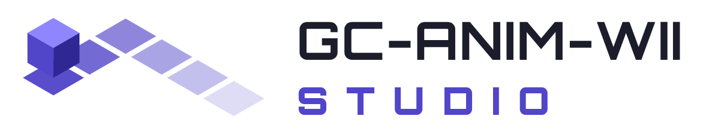

# GC-anim-Wii

<p align="center">
  
</p>

The GameCube boot animation, running natively on the Wii as a homebrew `.dol`, reproduced frame for frame from the GameCube IPL's own code and data.

It also has a second intro: the alternative GameCube intro seen in Nintendo's promotional videos, which never shipped on the console (see [The promo intro](#the-promo-intro)). `gc-anim.ini` picks which one plays.

Nothing from Nintendo is distributed. The models, textures, animations and the jingle are read at run time from **your own GameCube IPL dump** on SD or USB.

This v2 was produced with the help of Claude. The original recreation, crafted by hand without AI, is still available in the [legacy branch](https://github.com/supertazon/GC-anim-Wii/tree/legacy).

## Installation

1. You need a softmodded Wii with the Homebrew Channel (<https://wii.guide/>), and Priiloader if you want to use the animation as a boot animation.
2. Download `GC-anim-Wii-v2.0.zip` from the [Releases](https://github.com/supertazon/GC-anim-Wii/releases) page and extract it to the root of the SD card (or USB drive). This creates `apps/gc-anim-wii/` with `boot.dol`, `meta.xml`, `icon.png`, `promo.wav` (the promo intro's sound) and a `gc-anim.ini` to edit.
3. Put your GameCube IPL dump there as `ipl.bin`. The names `iplusa.bin`, `iplpal.bin` and `ipljap.bin` (Nintendont's naming) also work. If it isn't in `apps/gc-anim-wii/`, it is also looked for at the root of the SD card, then of the USB drive. How to dump the IPL: [rWiiHacks Webhub guide](https://www.rwiihacks.com/tutorials/nintendont/#optional-dump-gamecube-bios-for-use-with-nintendont).
4. **Optional**, the Super Mario Bros. easter egg: put your own dump of *Super Mario Bros.* (NES, the original World/Japan release, `.nes` format) in the same folder, named `smb.nes`. During the IPL intro, press **B** on the GameCube controller (or **1** on a Wii Remote held sideways) early in the animation to launch SMB. `[smb] smb = 1-1` (World 1-1 only) or `full` (the whole game, with a single life) in `gc-anim.ini`. Details in **[SMB.md](SMB.md)**.
5. Test it from the Homebrew Channel.
6. To use it as the boot animation: in Priiloader, choose *Load/Install File* → gc-anim-wii, then *Settings* → *Autoboot: Installed File*. Also enable *Replace Health Screen with Backmenu* and save.

Without an IPL dump the program exits immediately to the System Menu. Whatever happens (end of the animation, skip, reset), it always ends in the System Menu, even when launched from the Homebrew Channel.

## What's new (v2)

- **No GRRLIB:** plain libogc/GX.
- **No ripped models:** the original J3D models are loaded straight from the IPL and drawn with the same GX state as the IPL's own renderer. That fixes the color and env-mapping problems of v1 for both cubes.
- **Exact animation:** the animation logic was reverse-engineered from the IPL (BS2) and ported to C. It matches a Dolphin FIFO capture of the real boot sequence on every one of its 331 frames: cube path, camera shakes, tiles, logo, NINTENDO letters, GAMECUBE text and fade-out.
- **Anti-aliasing like the original:** 3-sample AA with the two-pass top/bottom rendering the IPL uses.
- **All IPL versions:** NTSC 1.0/1.1/1.2 and PAL 1.0/1.1/1.2 (the assets are located through the IPL's resource directory and identified by name).
- **Video:**
  - 60 Hz (NTSC, PAL60, MPAL; 480i and 480p): the 60 Hz timings.
  - 50 Hz PAL: the PAL IPL's own 50 Hz timings (it has its own set) and its 520-line picture.
  - 16:9: the scene is widened, not stretched.
- **The alternate jingles:** hold **Z** on controller 1, or on all four controllers, while the console starts.
- **The promo intro:** `intro = promo` plays the alternative intro of Nintendo's promo videos instead, rebuilt in real time from the IPL's own logo and letters.
- **Random colors:** `color = random` draws a new color scheme at each boot.
- **Always back to the System Menu:** made to be installed in Priiloader as the Wii's boot animation.
- **Super Mario Bros. easter egg:** added the ability to play SMB either world 1-1 or full game (with only 1 life), inspired by: [Nintendo Gamecube intro but it's actually Super Mario Bros 1-1 (YouTube)](https://www.youtube.com/watch?v=lHE91NaDxLQ) by BlobVanDam  See **[SMB.md](SMB.md)**.

## Customization (optional)

<p align="center">
  <picture>
    <source media="(prefers-color-scheme: dark)" srcset="assets/gc-anim-wii-studio-logo-dark-bg.png">
    
  </picture>
</p>

The easiest way: **[GC-anim-Wii Studio](https://supertazon.github.io/gc-anim-wii-studio/)** previews the settings in your browser, designs the logotype, and writes `gc-anim.ini` for you. Put the file in `apps/gc-anim-wii/`, next to `boot.dol` (the release comes with one, without it, every setting keeps its default). The [GitHub repo](https://github.com/supertazon/gc-anim-wii-studio/) of the studio has a small video tutorial you can follow.

The main keys:

```ini
[general]
intro = ipl          ; ipl (the IPL's boot animation) or promo (the promo videos' intro)
skip = 0             ; 1 = A or Start skips the animation
camera = 1           ; C-stick (GameCube controller 1) orbits the camera
force_4_3 = 0        ; ignore the console's 16:9 setting
volume = 199         ; jingle volume 0-255 (199 = the IPL's own level)
delay = 0            ; ms of black screen before the animation (0-10000), for slow HDMI screens/mods

[colors]
color = 255,60,60    ; theme color (or random), see Colors below

[text]
letters = WIIBREW              ; replaces "NINTENDO": up to 16 letters A-Z and spaces
letters_spacing = natural      ; natural (NINTENDO's pitch) or fill (NINTENDO's width)
image = logo.png               ; replaces the "GAMECUBE" logotype (PNG, BMP, JPG or TGA, white on black or transparent)

[smb]
smb = full                     ; 1-1 or full
```

`camera`, the alternate jingles (Z) and the SMB easter egg are for `intro = ipl` only. The `delay` is counted in frames at the console's real refresh rate (50 Hz, or 59.94 Hz for NTSC, PAL60 and 480p), the same in both intros.

### Colors

Every key is optional. Colors are `R,G,B` or `#RRGGBB`. Each one is applied with the model's own shading, so it keeps the original lighting and shine.

| key | what it colors | default |
|---|---|---|
| `color` | everything below, unless set separately; `random`: see below | the original indigo |
| `cube` | the small rolling cube; `tiles` = takes the color of the tile appearing under it | `color` |
| `tiles` | the tiles' final colors: one color, a list of up to 16, or `rainbow` | `color` |
| `tiles_mode` | with a list: `cycle` (A B C A B C…) or `spread` (bands along the path) | `cycle` |
| `trail` | new tiles start in the cube's color and reach their own over this many tiles (0 = at once) | 0 |
| `logo` | the final 3D logo | the color that follows the last tile |
| `drop` | color the cube turns into on its final drop | `logo` |
| `drop_blend` | when: `fall` (the drop only), `jump` (rise and drop) or `off` | `fall` |
| `glass` | the glass cube flashing on the impacts | `logo` |
| `glass_opacity` | strength of those flashes, in % (0 = hidden) | 100 |
| `background` | the background, and the color of the final fade (`promo_background`: the promo intro's own, see below) | black |
| `text` | "NINTENDO" and "GAMECUBE" | white, or black on a light background |
| `hue`, `saturation`, `brightness` | global adjustment on top of all the above (degrees, %, %) | 0, 100, 100 |

The cube lays 16 tiles. With a shorter list, `cycle` repeats it and `spread` stretches it along the path. By the time the cube lands, all tiles have reached their final color.

**`color = random`:** a new color scheme at each boot (one color, a gradient, a stretch of the color wheel or a repeating motif), always vivid. It replaces `color`, `cube`, `tiles`, `tiles_mode` and `trail`; the other keys still apply. In the promo intro it gives a random theme color.

Examples:

```ini
; Famicom: gold cube, red trail, red logo
[colors]
cube  = 212,175,55
tiles = 113,21,33
trail = 4

; rainbow
[colors]
tiles = rainbow
cube  = tiles

; French flag
[colors]
tiles = 0,85,164  255,255,255  239,65,53
cube  = tiles

; black console
[colors]
color      = 40,40,45
background = 255,255,255
```

A very dark grey such as `40,40,45` keeps the 3D look; pure black flattens the models into silhouettes.

## The promo intro

`intro = promo` plays the alternative GameCube intro seen in [Nintendo's promotional videos](https://youtu.be/CjkYhI2MaPQ?si=BdSUqR9RyB1k-F6U&t=15): light streaks draw the cube, a glass cube "slams" into the solid logo, then the picture fades.
- **Logo, NINTENDO letters and GAMECUBE logotype:** read at run time from your IPL dump (`boot_demo_logo_mark` and `boot_demo_mat28` models), drawn as an isometric view in the promo's colors.
- **Sound:** `promo.wav`, included in the release, in `apps/gc-anim-wii/` (PCM 16-bit, mono or stereo, any rate). It isn't in the IPL. Without it the intro plays silently.
- **Timings, colors, streak paths and slam layers:** measured on the reference clip and stored in `source/anim_data.h` (generated by `tools/anim.py`). Nothing from Nintendo is in the source or the `.dol`.
- **Size and layout:** drawn 1.28× the clip's size, with its final layout matching the IPL's last frame (logo, NINTENDO and GAMECUBE each mapped onto their box in that frame).

Settings used by the promo intro:

| key | effect |
|---|---|
| `[general]` `skip`, `force_4_3`, `volume`, `delay` | as for the IPL intro (`volume = 199` is the promo's full level) |
| `color` | the logo and the light (streaks, glow, glass cube, slam) |
| `logo` | the final logo: the IPL's face textures recolored exactly as in the IPL intro. Without `logo` or `color`, the promo's pale lavender |
| `glass` | the light only: it takes this color's hue and saturation and keeps its own brightness. Without `glass`, the light follows `logo`, then `color` |
| `hue`, `saturation`, `brightness`, `glass_opacity` | as for the IPL intro |
| `background` | background and final fade. On a light background (the same rule as the IPL intro's black text), the light is drawn as ink: the theme color, darkened |
| `promo_background` | the promo's own background, when the IPL intro's doesn't suit it (default: `background`) |
| `text` | final NINTENDO / GAMECUBE color (NINTENDO a bit darker, as in the promo); default white, or black on a light background |
| `[text]` `letters`, `letters_spacing` | the custom letters replace NINTENDO, with the same spacing rules and alphabet as the IPL intro, drawn flat in the promo's style |
| `[text]` `image` (or `logo.png`) | the custom logotype replaces GAMECUBE, placed as in the IPL intro |

`cube`, `tiles`, `tiles_mode`, `trail`, `drop`, `drop_blend`, `camera`, the Z jingles and the SMB easter egg do nothing in the promo intro.

## Building

Requires devkitPro (devkitPPC, libogc, libfat).

```sh
make
```

This builds `GC-anim-Wii.dol` (named after the project folder); copy it to `apps/gc-anim-wii/` as `boot.dol`.

## How it works

| file | role |
|---|---|
| `source/ipl.c` | loads and descrambles the dump, finds the resource directory, extracts the assets by name |
| `source/j3d.c` | the IPL's model renderer: INF1 traversal, MAT1 materials → GX, shapes drawn from their display lists, env-map texture matrices, the "model alpha" TEV stage |
| `source/anim.c` | joint animation (`J3D1bck1`) and material color animation (`IPK1`) of the NINTENDO/GAMECUBE model |
| `source/intro.c` | the animation logic: drop, roll path, final jump, impact shakes, tiles, alphas, fade. Each function names the IPL routine it reproduces |
| `source/gcmath.c` | the IPL's 4096-entry sine table, Euler matrices and hermite interpolation, in the same float operation order |
| `source/scene.c` | the draw order, tiles, light and fade quad |
| `source/video.c` | render mode (592×448 or 592×520, VI-scaled to 640), AA two-pass copy, 16:9 |
| `source/ipl_audio.c` | locates and decodes the AFC jingle (WSYS/IBNK/sequence) |
| `source/recolor.c`, `source/textimg.c`, `source/config.c` | customization |
| `source/letters_data.c` | the custom alphabet's meshes (generated) |
| `source/promo.c`, `source/anim_data.h` | the promo intro: logo layers, light streaks, slam, glow; its timeline (generated by `tools/anim.py`) |
| `source/smb*.c`, `source/nes/`, `source/ipl_bank.c` | the Super Mario Bros. easter egg (details in [SMB.md](SMB.md)) |

`tools/` holds the generators of the two generated source files (Python 3):
- `letters_design.py` defines the custom alphabet; `make_letters.py` (needs shapely ≥ 2.1) extrudes it into `source/letters_data.c`;
- `anim.py` is the promo intro's timeline (timings, colors, streak paths, slam layers); `python3 tools/anim.py source/anim_data.h` regenerates the header.

## Acknowledgements

- [The BitBuilt community](https://bitbuilt.net/)
- [Aurelio](https://github.com/Aurelio92/) for the help with Wii homebrew and IPL asset extraction (v1)
- [Trevor](https://github.com/trevor403) for cubeboot, which inspired this project
- [DacoTaco](https://github.com/DacoTaco) for the return-to-menu fix
- Owen, Luig and Extrems' Discord server (v1)
- IPL descrambler by Segher Boessenkool (via flippyboot's ipl-decoder)
- [stb_image](https://github.com/nothings/stb) (public domain) for the custom logotype
- Nintendo, for the hardware and games
